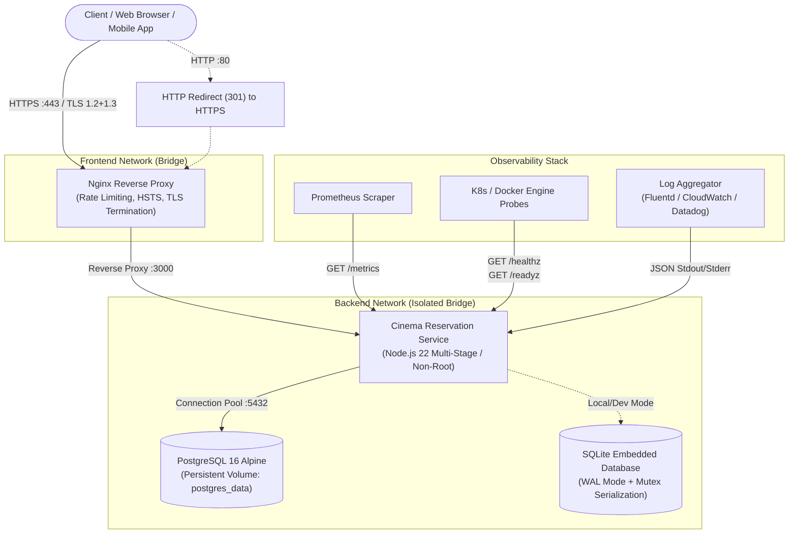
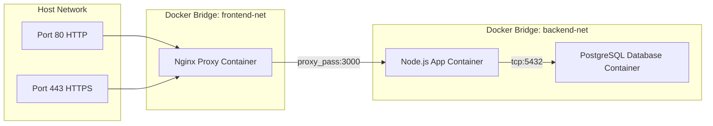
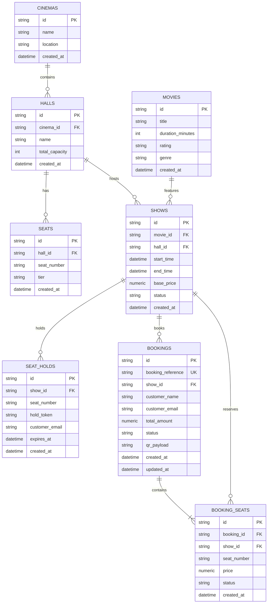
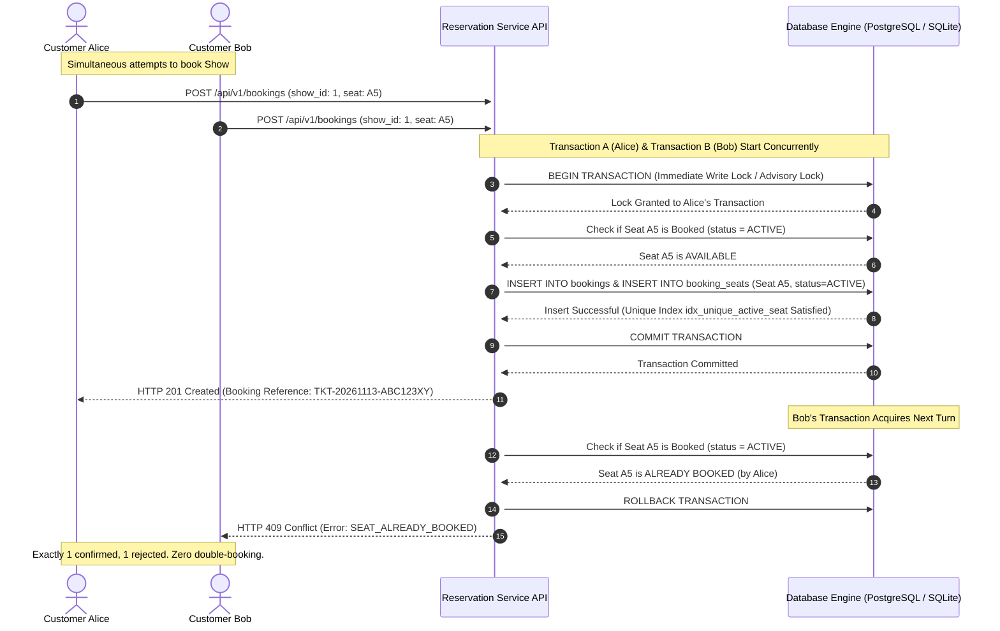
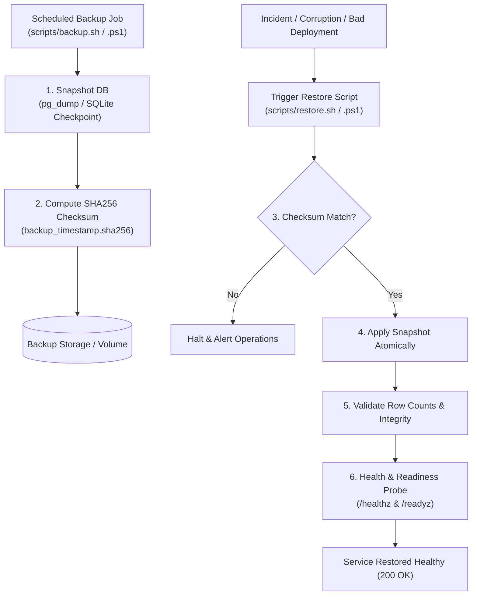

# Architecture Specification: Cinema Ticket Reservation Service

## 1. System Overview & Ingress Architecture

The Cinema Ticket Reservation Platform is architected as an observable, highly available microservice running within a segmented container network behind an Nginx reverse proxy providing TLS termination and rate limiting.

---

## 2. Network Topology & Security Boundaries

- **Principle of Least Privilege**:
  - The PostgreSQL database port (`5432`) is **not exposed** on the host. It resides entirely on the private internal Docker bridge network (`backend-net`).
  - Only the Nginx reverse proxy binds public host ports (`80` and `443`).
  - Application process runs as an unprivileged non-root user (`node`, UID 1000) inside an Alpine-based container.
  - Secret management: No real credentials or `.env` files are committed. All secrets are injected through environment variables.
  - Rate limiting: Nginx enforces a 30 req/sec rate limit with burst allowance to guard against DDoS or reservation scraping bots.

---

## 3. Database Entity Relationship (ER) Diagram

---

## 4. Concurrency & Race Condition Sequence Diagram

Enforcing that **two concurrent booking attempts for the same show and seat cannot both confirm** is achieved through database-level transactional locks and partial unique indices.

---

## 5. Automated Backup, Restore & Rollback Lifecycle

