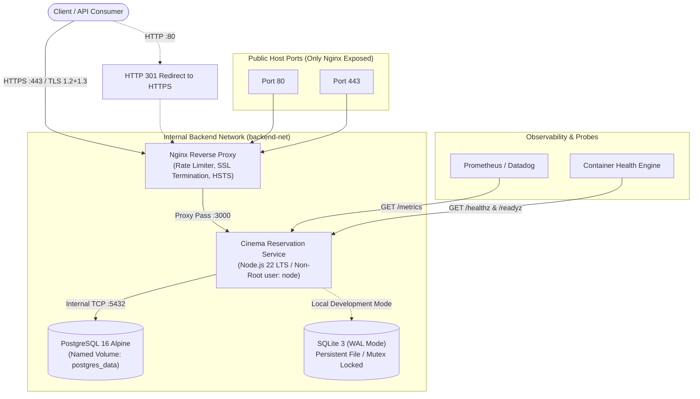

# Cinema Ticket Reservation Service (Show & Seat Reservation API)

[](.github/workflows/ci.yml)
[](package.json)
[](Dockerfile)
[](docker/nginx/nginx.conf)
[](src/db/schema.sql)
[](src/metrics.js)
[](evidence/acceptance-test-report.json)

A production-grade, domain-specific microservice implementing the **Show and Seat Reservation API** for cinema hall ticket booking. Engineered with a strong focus on containerization, CI/CD automation, high-concurrency race condition control, observability, backup/recovery, and zero-downtime rollbacks.

---

## 1. Executive Summary & Allocated Scope

- **Domain**: Cinema Hall Ticket Booking
- **Allocated Service**: Show and Seat Reservation API
- **Engineering Highlights**:
  - **Atomic Concurrency Guarantee**: Strict database-level serializability and unique constraints prevent double-booking. Two concurrent requests for the same seat/show cannot both confirm (1 confirms `201`, 1 fails `409 Conflict`).
  - **Seat Hold & Expiry Lifecycle**: Temporary hold mechanism (e.g. 5 minutes) with automated background cleanup and status tracking (`AVAILABLE`, `HELD`, `BOOKED`).
  - **Decoupled Observability**: Liveness (`/healthz`) and readiness (`/readyz`) probes, structured JSON logging with correlation IDs (`X-Request-ID`), and Prometheus metrics (`/metrics`).
  - **Secure Containerization**: Multi-stage Dockerfile running as unprivileged non-root user (`node`, UID 1000).
  - **Defense-in-Depth Networking**: Isolated internal network (`backend-net`) keeps database completely unexposed. Nginx reverse proxy handles TLS 1.3 termination, rate limiting, and HTTP-to-HTTPS redirection.
  - **Automated Disaster Recovery**: Scripted backup with SHA256 checksum verification, atomic database restore, and automated application rollback.

---

## 2. Architecture Overview



Detailed diagrams (ER Model, Concurrency Sequence Diagram, Disaster Recovery Flow) are available in [ARCHITECTURE.md](ARCHITECTURE.md).

---

## 3. Port Map & Network Separation

| Component | Service Name | Container Name | Host Binding | Internal Network Port | Security & Access Rule |
| :--- | :--- | :--- | :--- | :--- | :--- |
| **Reverse Proxy** | `reverse-proxy` | `cinema-reverse-proxy` | `0.0.0.0:80` | `80` | Public ingress; redirects all HTTP to HTTPS |
| **Reverse Proxy** | `reverse-proxy` | `cinema-reverse-proxy` | `0.0.0.0:443` | `443` | Public ingress; TLS 1.3, rate limit (30 req/s), HSTS |
| **Microservice** | `cinema-api` | `cinema-api-service` | **Unexposed** | `3000` | Internal network only; accessible only through Nginx |
| **Database** | `postgres-db` | `cinema-postgres-db` | **Unexposed** | `5432` | Internal network only; persistent storage on `postgres_data` |

---

## 4. Quickstart Guide

### Option A: Production Container Deployment (Docker Compose)
```bash
# 1. Clone repository
git clone https://github.com/arinkaushal/cinema-ticket-reservation-service.git
cd cinema-ticket-reservation-service

# 2. Configure environment (never commit .env!)
cp .env.example .env

# 3. Generate local development TLS certificates
./scripts/generate-certs.sh     # Linux / POSIX
# or PowerShell: .\scripts\generate-certs.ps1

# 4. Build and start services in detached mode
docker compose up -d --build

# 5. Verify container health status
docker compose ps
```

Access the service:
- **API Base URL**: `https://localhost/api/v1/shows`
- **Liveness Probe**: `https://localhost/healthz`
- **Readiness Probe**: `https://localhost/readyz`
- **Prometheus Metrics**: `https://localhost/metrics`

*(Note: Use `curl -k` to accept the self-signed localhost certificate during development)*

---

### Option B: Local Zero-Dependency Development
If Docker is not currently running, the service seamlessly falls back to embedded SQLite with zero external setup:
```bash
# Install dependencies
pnpm install

# Run database migrations and seed catalog
pnpm run db:migrate
pnpm run db:seed

# Start the application
pnpm start
# Listening on http://localhost:3000
```

---

## 5. API Reference & Usage Examples

### 5.1 Health & Readiness Probes
#### Liveness Check
```bash
curl -k https://localhost/healthz
```
```json
{
  "status": "ok",
  "uptime_seconds": 185,
  "timestamp": "2026-11-13T12:50:00.000Z",
  "service": "cinema-ticket-reservation-service",
  "version": "1.0.0"
}
```

#### Readiness Check (Validates Database Engine Query Capability)
```bash
curl -k https://localhost/readyz
```
```json
{
  "status": "ready",
  "database": "connected",
  "engine": "postgresql",
  "timestamp": "2026-11-13T12:50:00.000Z"
}
```

---

### 5.2 Shows & Seat Map
#### List All Scheduled Shows
```bash
curl -k https://localhost/api/v1/shows
```
```json
{
  "count": 3,
  "shows": [
    {
      "id": "show-interstellar-imax",
      "movie": {
        "id": "mov-interstellar",
        "title": "Interstellar: 10th Anniversary IMAX",
        "duration_minutes": 169,
        "rating": "PG-13",
        "genre": "Sci-Fi / Adventure"
      },
      "hall": {
        "id": "hall-imax-01",
        "name": "Screen 1 - IMAX Laser",
        "total_capacity": 40
      },
      "timing": {
        "start_time": "2026-11-20T18:00:00Z",
        "end_time": "2026-11-20T21:00:00Z"
      },
      "pricing": { "base_price": 18.5 },
      "seats": {
        "total": 40,
        "booked": 0,
        "held": 0,
        "available": 40
      },
      "status": "ACTIVE"
    }
  ]
}
```

#### Retrieve Real-Time Seat Map Grid
```bash
curl -k https://localhost/api/v1/shows/show-interstellar-imax/seats
```
```json
{
  "show_id": "show-interstellar-imax",
  "hall_id": "hall-imax-01",
  "summary": { "total": 40, "available": 38, "held": 1, "booked": 1 },
  "seats": [
    { "seat_number": "A1", "tier": "STANDARD", "price": 18.5, "status": "AVAILABLE" },
    { "seat_number": "A2", "tier": "STANDARD", "price": 18.5, "status": "HELD", "hold": { "expires_at": "2026-11-13T13:00:00Z" } },
    { "seat_number": "A3", "tier": "STANDARD", "price": 18.5, "status": "BOOKED" }
  ]
}
```

---

### 5.3 Temporary Seat Hold & Expiry
#### Create Temporary Hold (Locks Seat for 300 Seconds)
```bash
curl -k -X POST https://localhost/api/v1/shows/show-interstellar-imax/holds \
  -H "Content-Type: application/json" \
  -d '{
    "seat_numbers": ["B1", "B2"],
    "customer_email": "customer@example.com",
    "duration_seconds": 300
  }'
```
```json
{
  "message": "Temporary seat hold created successfully",
  "hold": {
    "hold_token": "HOLD-6e3a9c7b-912f-45a8-9d62-77eb40b01c31",
    "show_id": "show-interstellar-imax",
    "seat_numbers": ["B1", "B2"],
    "customer_email": "customer@example.com",
    "expires_at": "2026-11-13T13:05:00.000Z",
    "expires_in_seconds": 300
  }
}
```

---

### 5.4 Confirm Booking (Enforces Atomic Concurrency)
#### Create Confirmed Booking (From Hold or Direct)
```bash
curl -k -X POST https://localhost/api/v1/bookings \
  -H "Content-Type: application/json" \
  -d '{
    "show_id": "show-interstellar-imax",
    "seat_numbers": ["B1", "B2"],
    "customer_name": "Arin Kaushal",
    "customer_email": "arinkaushal06@gmail.com",
    "hold_token": "HOLD-6e3a9c7b-912f-45a8-9d62-77eb40b01c31"
  }'
```
```json
{
  "message": "Booking confirmed successfully",
  "booking": {
    "id": "c1f7a0b3-128a-4932-a5e2-632da84a9e22",
    "booking_reference": "TKT-20261113-ABCD12",
    "show": {
      "id": "show-interstellar-imax",
      "movie_title": "Interstellar: 10th Anniversary IMAX",
      "hall_name": "Screen 1 - IMAX Laser",
      "start_time": "2026-11-20T18:00:00Z"
    },
    "customer": {
      "name": "Arin Kaushal",
      "email": "arinkaushal06@gmail.com"
    },
    "seats": [
      { "seat_number": "B1", "tier": "STANDARD", "price": 18.5 },
      { "seat_number": "B2", "tier": "STANDARD", "price": 18.5 }
    ],
    "total_amount": 37.0,
    "status": "CONFIRMED",
    "qr_payload": "{\"ticket_id\":\"TKT-20261113-ABCD12\",\"show_id\":\"show-interstellar-imax\",\"seats\":[\"B1\",\"B2\"]}",
    "created_at": "2026-11-13T13:00:00.000Z"
  }
}
```

#### Concurrent Booking Conflict Response (HTTP 409)
If another user or request attempts to book the same seat:
```json
{
  "error": {
    "code": "CONCURRENT_BOOKING_CONFLICT",
    "message": "One or more of the selected seats were just booked by another user. Please choose another seat.",
    "status": 409,
    "request_id": "b3e02581-2245-4e78-98e3-057bf2ca07e4",
    "timestamp": "2026-11-13T13:00:00.050Z"
  }
}
```

---

### 5.5 Simulated Cancellation (Frees Seat)
```bash
curl -k -X POST https://localhost/api/v1/bookings/TKT-20261113-ABCD12/cancel
```
```json
{
  "message": "Booking cancelled successfully and seats released",
  "cancellation": {
    "booking_reference": "TKT-20261113-ABCD12",
    "status": "CANCELLED",
    "released_seats": ["B1", "B2"],
    "refund_status": "SIMULATED_REFUND_COMPLETED",
    "cancelled_at": "2026-11-13T13:05:00.000Z"
  }
}
```

---

## 6. Acceptance Tests & Reproducibility Verification

All 5 core acceptance criteria are verified automatically via:
```bash
pnpm run verify:all
# or: node scripts/verify-all.js
```

### The 5 Verified Acceptance Scenarios:
1. **Concurrency**: Under simultaneous requests for the exact same show and seat, **only 1 request confirms (`201`)** and all competing requests are rejected with **`409 Conflict`**. Tested and verified under 20-thread concurrency.
2. **Clean Environment**: Clean checkout starts automatically with zero manual DB configuration via automated migration and catalog seed.
3. **CI/CD Pipeline**: GitHub Actions workflow checks static analysis, secret leaks, runs automated tests, builds container, and tags images with Git SHA and SemVer tags.
4. **Chaos & Observability**: Service actively reports `/healthz`, `/readyz`, structured logs, and metrics. During simulated database outage, `/readyz` immediately detects failure (`503`), emits structured alerts, and restores cleanly upon database recovery (`200`).
5. **Backup & Recovery**: Database snapshot taken with SHA256 verification, state mutation injected, database restored from snapshot, and data integrity verified returned to baseline.

Full evidence report: [`evidence/acceptance-test-report.json`](evidence/acceptance-test-report.json).

---

## 7. Operational Procedures & Runbook

Refer to [`RUNBOOK.md`](RUNBOOK.md) for complete operator runbooks, including:
- **Deployment & Restart**: Rolling restart, container lifecycle management.
- **Monitoring & Metrics**: Prometheus queries and alert thresholds.
- **Backup Execution**: `./scripts/backup.sh` / `.\scripts\backup.ps1`
- **Restore Execution**: `./scripts/restore.sh` / `.\scripts\restore.ps1`
- **Rollback Execution**: `node scripts/rollback.js` / `./scripts/rollback.sh`
- **Incident Response Playbooks**: Database failure, traffic spikes, concurrency conflicts.

---

## 8. Environment Variables Reference

| Variable | Default Value | Description |
| :--- | :--- | :--- |
| `NODE_ENV` | `development` | Node environment (`production` or `development`) |
| `PORT` | `3000` | Application HTTP listen port |
| `HOST` | `0.0.0.0` | Application bind address |
| `DATABASE_URL` | `sqlite:./data/cinema.db` | PostgreSQL or SQLite connection URI |
| `POSTGRES_USER` | `cinema_user` | PostgreSQL database username |
| `POSTGRES_PASSWORD`| `cinema_secure_password_2026` | PostgreSQL password (change in production!) |
| `POSTGRES_DB` | `cinema_db` | PostgreSQL database name |
| `HOLD_DURATION_SECONDS` | `300` | Lifetime in seconds for temporary seat holds |
| `LOG_LEVEL` | `info` | Minimum log severity level (`debug`, `info`, `warn`, `error`) |

---

## 9. Security & Hardening Checklist

- [x] Unprivileged non-root container execution (`USER node`, UID 1000).
- [x] Internal Docker network isolation (`backend-net` unexposed).
- [x] Nginx TLS 1.3 termination with modern cipher suites.
- [x] HTTP to HTTPS automatic 301 redirection.
- [x] Strict Security Headers (HSTS, CSP, X-Frame-Options, X-Content-Type-Options).
- [x] Rate limiting to mitigate brute-force seat reservation attacks.
- [x] Correlation tracing with `X-Request-ID`.
- [x] Zero hardcoded secrets, verified via automated CI scan (`scripts/lint-check.js`).
- [x] SHA256 checksum verification on all database backup restores.
